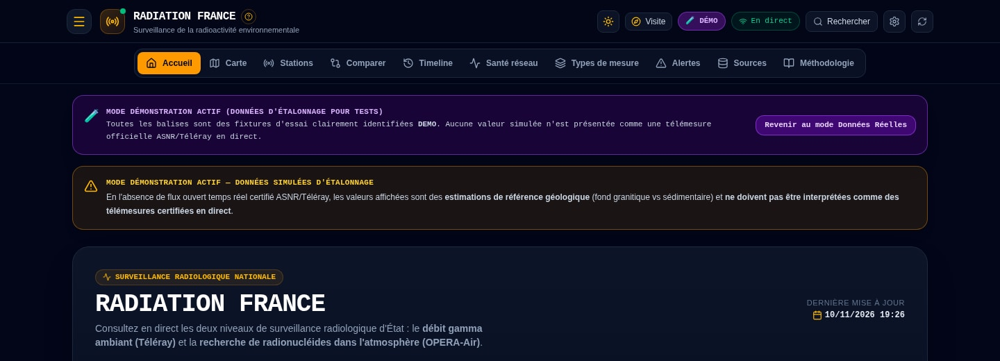
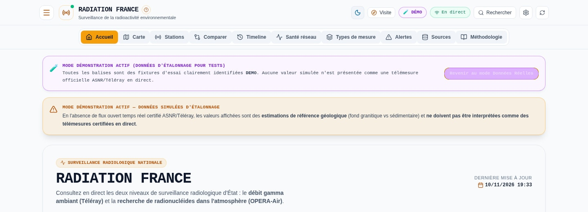
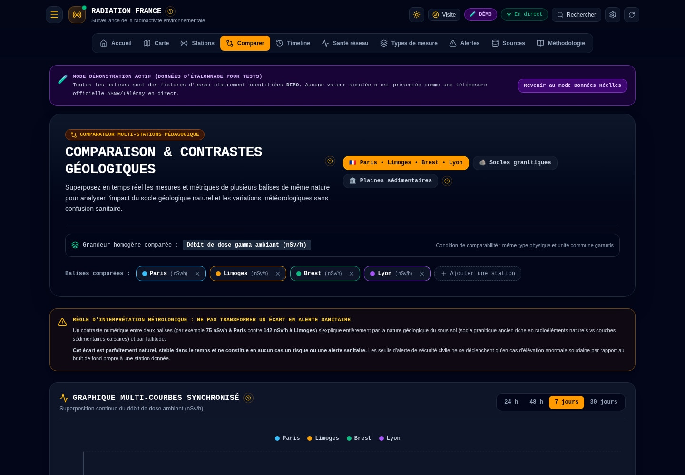
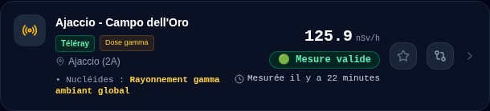
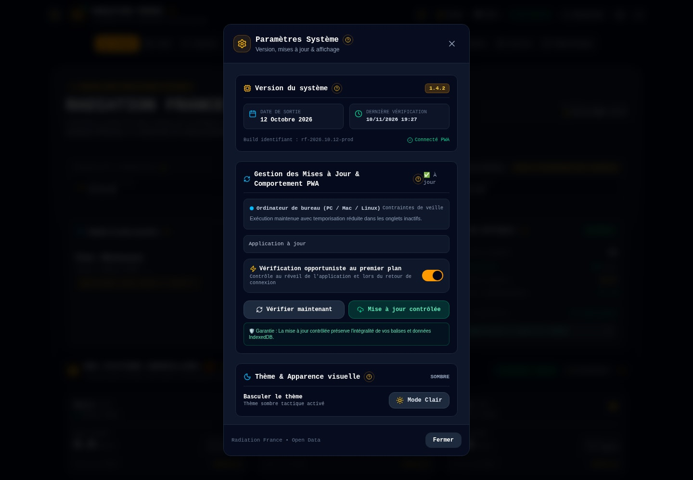
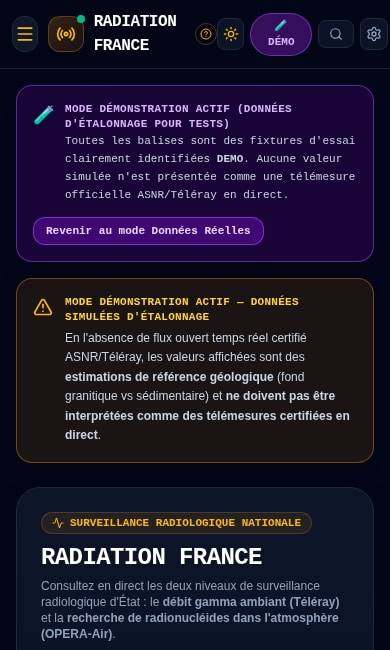

<p align="center">
  
</p>

<h1 align="center">Radiation France — Surveillance radiologique</h1>

<p align="center">
  Une interface indépendante pour explorer les réseaux et les données de surveillance radiologique.
</p>

<p align="center">
  <a href="https://radiation-france-surveillance-radiologique.ai.studio/">Ouvrir l’application de référence</a>
  ·
  <a href="https://github.com/pnoualhier/Radiator">Voir le dépôt</a>
</p>

> **À lire avant d’interpréter les mesures.** Le dépôt contient des données de démonstration et des valeurs locales préchargées qui ne sont pas toutes reliées à un flux institutionnel. Le mode **DÉMO** affiche des données d’essai, pas des mesures réelles. Un catalogue de stations n’est pas une preuve de réception de mesures en direct. En cas d’urgence, suivez exclusivement les consignes des autorités.

## Sommaire

- [Présentation](#présentation)
- [Aperçu de l’interface](#aperçu-de-linterface)
- [Fonctionnalités et limites actuelles](#fonctionnalités-et-limites-actuelles)
- [Sources de données et attribution](#sources-de-données-et-attribution)
- [Expérience utilisateur et mode hors connexion](#expérience-utilisateur-et-mode-hors-connexion)
- [Architecture technique](#architecture-technique)
- [Installation et lancement](#installation-et-lancement)
- [Licence et responsabilité](#licence-et-responsabilité)
- [Contribuer](#contribuer)

## Présentation

**Radiation France** (dépôt **Radiator**) est une application web qui rassemble une interface cartographique, un annuaire de stations, des outils de comparaison et des pages d’information autour de la surveillance radiologique environnementale. Le projet vise à rendre les unités, les sources et les limites des données plus faciles à consulter.

Le projet est indépendant et n’est ni affilié à l’ASNR ou à l’IRSN, ni approuvé par ces organismes. Il ne constitue pas un dispositif officiel de surveillance ou d’alerte et ne remplace pas leurs publications.

## Aperçu de l’interface

Les captures ci-dessous ont été réalisées dans le dépôt local, avec le mode **DÉMO** explicitement activé. Les valeurs d’essai ne sont pas des télémesures et ne doivent pas être reprises comme données radiologiques. Voir le [catalogue des captures et les écrans non publiés](docs/SCREENSHOTS_CATALOG.md).

<p align="center">
  
</p>

| Écran | Aperçu |
|---|---|
| Tableau de bord, thème clair |  |
| Comparaison de stations |  |
| Carte d’une station du jeu d’essai |  |
| Paramètres système |  |
| Affichage mobile |  |

Les images de carte, de sources, d’alertes et de chronologie n’ont pas été publiées : les écrans disponibles mêlent des valeurs locales ou préchargées à des présentations qui peuvent les faire passer pour des données réelles. Les raisons détaillées figurent dans le [catalogue](docs/SCREENSHOTS_CATALOG.md).

## Fonctionnalités et limites actuelles

L’interface comprend les modules suivants. Leur présence dans l’application ne garantit pas que les données affichées proviennent d’un flux réel ou soient vérifiées par leur producteur.

| Module | Ce que contient l’interface | Limite importante |
|---|---|---|
| Tableau de bord | Accueil, station mise en avant, favoris, raccourcis et synthèse du réseau | Certains compteurs de santé du serveur sont des valeurs codées en dur. Ne pas les citer comme état opérationnel réel. |
| Carte | Carte Leaflet, marqueurs, regroupement, filtres, modes d’affichage et couche d’interpolation | Les couches et valeurs préchargées ne sont pas toutes des mesures vérifiées. L’interpolation est une estimation, pas une mesure continue. |
| Stations | Recherche par nom, commune, département ou réseau, filtres et favoris | Le catalogue contient des métadonnées et des jeux d’essai ; leur présence ne prouve pas une mesure en direct. |
| Comparaison | Sélection de stations, courbes et périodes comparables | Les séries fournies en mode DÉMO sont synthétiques. |
| Alertes | Registre et interface de consultation d’alertes | Le registre initial contient des entrées locales préchargées ; l’existence du module ne confirme pas une veille officielle en temps réel. |
| Chronologie | Événements organisés par date et période | Les entrées sont intégrées au code et ne sont pas un flux historique officiel vérifié. |
| Sources et méthodologie | Informations sur les réseaux, les unités et les principes de mesure | Les statuts visibles dans certaines pages ne sont pas tous cohérents avec les réponses de l’API ; consulter les limites des sources ci-dessous. |
| Paramètres | Thème, informations de version et options de mise à jour | Les informations de version affichées dépendent des constantes de l’application et ne certifient pas la version du site de référence. |

### État des sources dans ce dépôt

Le frontend utilise les routes `/api/v1` du serveur Express défini dans `server.ts`. Le backend Python distinct possède aussi des connecteurs, mais il n’est pas branché automatiquement au frontend. Un connecteur présent dans le code n’est donc pas nécessairement actif.

| Source | État vérifié dans le code | Nature et précaution |
|---|---|---|
| **Téléray — ASNR** | Le serveur tente de récupérer le catalogue des stations. Le flux public de mesures directes n’est pas disponible par cette intégration. | Les mesures visibles en mode DÉMO sont des données d’essai. Le catalogue ne constitue pas une télémesure. |
| **OpenRadiation** | Un connecteur de récupération directe est présent ; la disponibilité dépend du service et de sa configuration. | Ne considérer une mesure comme réelle que si sa provenance et son statut de source sont explicitement confirmés. |
| **Safecast** | Un connecteur existe ; le code contient aussi des points de base et des données locales qui ne prouvent pas une connexion au flux. | Ne pas assimiler les valeurs préchargées à des données Safecast en direct. |
| **EURDEP** | Connecteur présent dans le backend Python ; aucune intégration de mesures en direct n’est confirmée dans le serveur frontend par défaut. | Les stations ou valeurs locales éventuellement affichées ne sont pas une preuve d’accès au flux européen. |
| **OPERA-Air** | Pages et structures de données présentes ; le dépôt comporte des valeurs locales préchargées, sans flux direct confirmé dans l’application frontend. | Ne pas présenter ces valeurs comme résultats actuels de laboratoire. |
| **HydroTéléray** | Pages et structures de données présentes ; le dépôt comporte des valeurs locales préchargées, sans flux direct confirmé dans l’application frontend. | Ne pas présenter ces valeurs comme mesures actuelles de l’eau. |

Les réponses de statut disponibles à l’exécution sont plus pertinentes que les badges ou descriptions statiques de l’interface, mais elles ne remplacent pas la vérification auprès du producteur. Pour les seuils, mesures et alertes, consulter les publications officielles.

### Références et attribution des données

Le code et la documentation du dépôt mentionnent les producteurs et licences suivants. Ces mentions décrivent les références actuellement inscrites dans le projet ; elles ne constituent pas une vérification juridique des conditions en vigueur. Vérifier les conditions du producteur avant toute redistribution ou réutilisation.

| Réseau / ressource | Producteur ou référence | Attribution à conserver |
|---|---|---|
| Téléray, HydroTéléray, OPERA-Air | ASNR (anciennement ASN / IRSN) | « Source : ASNR — [nom du réseau] », avec date ou horodatage lorsque disponible. |
| EURDEP | Commission européenne, Joint Research Centre (JRC) | Mentionner EURDEP/JRC et signaler les transformations, filtres ou agrégations appliqués. |
| OpenRadiation | Contributeurs OpenRadiation | Citer [OpenRadiation](https://openradiation.org) et vérifier les obligations ODbL documentées par le projet. |
| Safecast | Réseau Safecast | Citer [Safecast](https://safecast.org) ; la documentation du dépôt indique CC0, à confirmer auprès du producteur. |
| Fond cartographique | Contributeurs OpenStreetMap | « © [Contributeurs OpenStreetMap](https://www.openstreetmap.org/copyright) ». |

Voir [docs/sources.md](docs/sources.md) pour le statut des connecteurs et les réserves associées.

## Expérience utilisateur et mode hors connexion

- L’interface est adaptative et propose un thème sombre et un thème clair.
- Le manifeste PWA, les icônes et le service worker sont configurés dans le projet. Le service worker est désactivé dans le serveur de développement.
- Workbox prévoit la mise en cache des ressources statiques, des tuiles OpenStreetMap et de certaines réponses API. Les données consultables hors connexion dépendent de ce qui a déjà été mis en cache sur l’appareil.
- Dexie stocke des données dans IndexedDB et `ApiService` tente de relire son cache après une erreur réseau. Cela ne garantit ni une première utilisation hors connexion, ni des données fraîches, ni la disponibilité de tous les modules.

**Ne pas traiter un cache local, une donnée périmée ou une valeur de démonstration comme une mesure actuelle.**

## Architecture technique

Le dépôt comprend deux serveurs distincts :

1. **Application web par défaut** : React, TypeScript et Vite ; `npm run dev` démarre `server.ts`, un serveur Express qui sert Vite en développement et expose les routes frontend `/api/v1`.
2. **Backend Python séparé** : FastAPI, SQLAlchemy et connecteurs dans `backend/`. Il n’est pas lancé par `npm run dev` et le frontend par défaut n’est pas configuré pour l’utiliser.

Les principaux composants sont React 19, Vite 8, Tailwind CSS 4, Leaflet / React-Leaflet pour les cartes, Recharts pour les graphiques, Dexie / IndexedDB pour le cache local et `vite-plugin-pwa` / Workbox pour les fonctionnalités PWA. La configuration et ses limites sont détaillées dans [docs/architecture.md](docs/architecture.md).

## Installation et lancement

### Application web

Prérequis conseillés : Node.js 22 et npm. Depuis la racine du dépôt :

```bash
git clone https://github.com/pnoualhier/Radiator.git
cd Radiator
npm install --legacy-peer-deps
npm run dev
```

Le serveur de développement écoute sur [http://localhost:3000](http://localhost:3000). Le drapeau `--legacy-peer-deps` est actuellement nécessaire avec npm en raison d’un conflit de versions déclaré entre Vite 8 et esbuild ; l’installation simple `npm install` échoue lors de la résolution des dépendances.

Pour générer les fichiers de production :

```bash
npm run build
```

Le serveur de développement n’active pas le service worker ; il ne permet donc pas de valider à lui seul l’installation PWA ou le comportement complet hors connexion.

### Backend Python indépendant

Le backend est facultatif pour lancer le frontend. Pour l’exécuter séparément, depuis le dépôt :

```bash
cd backend
python3 -m venv .venv
source .venv/bin/activate
pip install -r requirements.txt
uvicorn app.main:app --reload
```

L’API et sa documentation interactive sont alors accessibles par défaut sur `http://localhost:8000` et `http://localhost:8000/docs`. Les paramètres de connexion aux sources et à la base doivent être configurés séparément. N’utilisez pas de clés réelles dans des captures, des commits ou des fichiers publics.

## Licence et responsabilité

Le README antérieur annonçait une licence MIT, mais le dépôt ne contient pas de fichier `LICENSE` ni de champ `license` dans `package.json` permettant de confirmer une licence globale. Un fichier source porte une mention SPDX Apache-2.0 : cette mention isolée ne résout pas la licence du dépôt entier. Clarifier ce point avant de réutiliser le code.

L’application est fournie à titre informatif. Les mesures, métadonnées, caches et textes peuvent être incomplets, périmés, indisponibles ou erronés. Elle n’est pas un instrument de décision sanitaire ou de sécurité. En cas d’événement radiologique, suivre les consignes des autorités françaises, de la préfecture et de [FR-Alert](https://www.fr-alert.gouv.fr/), et consulter les informations de l’[ASNR](https://www.asnr.fr/).

## Contribuer

Les contributions et signalements peuvent être soumis via les [issues](https://github.com/pnoualhier/Radiator/issues) et les pull requests du dépôt. Inclure les étapes de reproduction et le contexte technique utile ; ne pas joindre de clés, de données personnelles ou de coordonnées précises.

Pour préparer une future page d’accueil indépendante, consulter le [catalogue des captures](docs/SCREENSHOTS_CATALOG.md) et les ressources visuelles associées.
