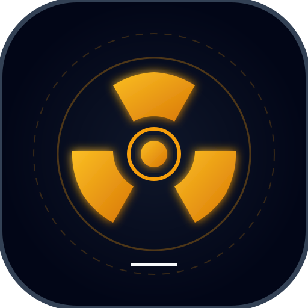
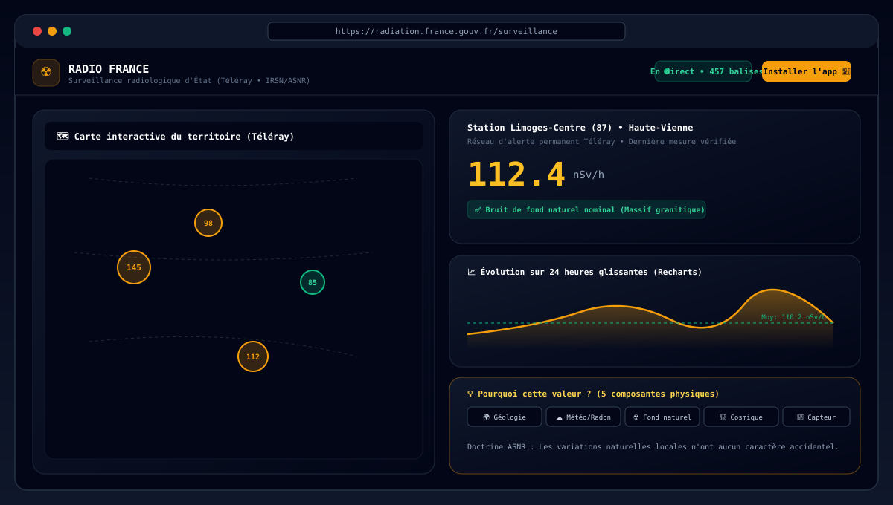

<p align="center">
  
</p>

<h1 align="center">Radiation France — Surveillance Radiologique d'État & Citoyenne ☢️🇫🇷</h1>

<p align="center">
  <strong>PWA de surveillance environnementale de la radioactivité en France métropolitaine et Corse</strong><br>
  <em>Données certifiées Téléray (ASNR / IRSN), HydroTéléray, OPERA-Air, EURDEP, OpenRadiation et Safecast</em>
</p>

<p align="center">
  
  
  
  
  
  
</p>

---

## 📸 Aperçu de l'Interface

<p align="center">
  
</p>

---

## 🌟 Fonctionnalités Majeures

### 🍔 1. Menu Hamburger Catégorisé
Un tiroir de navigation ergonomique regroupe l'ensemble des modules applicatifs par domaines d'expertise :
- **📡 Surveillance & Cartographie :** Accueil national, carte interactive, annuaire des 457 balises.
- **📊 Analyses & Outils :** Comparateur multi-balises (jusqu'à 4 simultanées), types de mesure, timeline historique 2026.
- **🚨 Réseau & Santé :** Alertes officielles de sécurité civile, santé de la télésurveillance, registre des sources.
- **📖 Pédagogie & Métrologie :** Méthodologie scientifique, visite guidée, mentions légales.
- **⚙️ Système & Paramètres :** Paramètres système, thème clair/sombre, installation PWA.

### ⚙️ 2. Paramètres Système & Mises à Jour Automatiques en Arrière-Plan
- **Traçabilité logicielle :** Affichage de la date de sortie (`12 Octobre 2026`) et de la version logicielle (`v1.4.2`).
- **Date de dernière vérification :** Horodatage précis du dernier contrôle serveur.
- **Bouton « Vérifier les mises à jour » :** Contrôle instantané de la signature du Service Worker et de l'API.
- **Bouton « Forcer la mise à jour » :** Purge complète des caches de stockage (`CacheStorage`), désenregistrement des anciens Service Workers et rechargement propre.
- **Système automatique en arrière-plan :** Tâche périodique (toutes les 15 minutes) qui vérifie en tâche de fond la disponibilité de nouveaux correctifs et les applique de manière transparente.

### ☀️ 3. Mode Clair & Mode Sombre Haute Lisibilité
- Bascule fluide entre le **thème sombre tactique** (confort visuel de nuit) et le **thème clair à fort contraste**.
- Adaptation intelligente des fonds de carte OpenStreetMap (tuiles naturelles en mode clair, filtre nuit en mode sombre).
- Persistance locale du choix utilisateur dans le navigateur (`localStorage`).

### 📱 4. Bouton « Installer l'application » (PWA Native)
- Permet en un clic d'installer l'application sur l'écran d'accueil d'un mobile (Android/iOS) ou sur le bureau d'un ordinateur (PC, Mac, Linux).
- Fonctionnement **100% autonome hors connexion** grâce à une base locale IndexedDB stockant plus de 12 000 télémesures et séries temporelles.
- Guide visuel pas-à-pas dédié pour les utilisateurs d'iPhone / iPad sous Safari.

### 💡 5. Outil Pédagogique « Pourquoi cette valeur ? »
Pour chaque balise (ex. `112 nSv/h`), l'application décompose les 5 composantes physiques réelles qui expliquent ce niveau et ses variations :
1. **🌍 Géologie locale :** Rayonnement tellurique du sous-sol (massifs granitiques bretons/auvergnats vs bassins sédimentaires parisiens).
2. **☁️ Météorologie (Pluie & Radon) :** Phénomène de *washout* provoquant une hausse transitoire de +20% à +80% pendant les averses.
3. **☢️ Rayonnement naturel :** Bruit de fond nominal moyen métropolitain (50 à 250 nSv/h).
4. **🌌 Rayonnement cosmique :** Dépendance directe à l'altitude (+15 nSv/h par 1 000 mètres).
5. **📡 Instrumentation :** Bruit statistique de Poisson (± 5 nSv/h) inhérent aux compteurs physiques.

### 📜 6. Timeline des Événements & Juxtaposition Analytique (2026)
Arborescence chronologique interactive mois par mois (`Jan`, `Fév`, `Mars`...) juxtaposant systématiquement :
- **🔵 Mesure Téléray :** Valeurs de fond et pics enregistrés.
- **🔴 Alertes officielles :** Communiqués ASNR / IRSN, classements sur l'échelle INES (Niveau 0, Niveau 1, Exercices PPI).
- **⛅ Événements environnementaux :** Épisodes orageux, poussières sahariennes, crues de la Loire, éjections solaires.

### ⚖️ 7. Mentions Légales & Avertissement de Non-Responsabilité
- Onboarding obligatoire à la première visite stipulant expressément que **l'auteur indépendant n'est pas responsable des données fournies** par les réseaux publics d'État ou citoyens.
- Rappel formel que l'application est un outil citoyen consultatif qui ne remplace pas les alertes d'urgence des préfectures, de la Sécurité Civile ou de l'ASNR.

### 🧭 8. Visite Guidée Contextuelle & Infobulles
- Parcours interactif pas-à-pas en 4 étapes pour les nouveaux utilisateurs.
- Infobulles d'aide contextuelle (`?`) disséminées sur les grandeurs physiques clés (`nSv/h`, Téléray, $H^*(10)$).

---

## 🏛️ Sources & Réseaux de Surveillance Connectés

| Réseau | Organisme producteur | Type | Nature des télémesures |
| :--- | :--- | :--- | :--- |
| **Téléray** | ASNR / IRSN (État Français) | Institutionnel | 457 sondes fixes continues ($H^*(10)$ en nSv/h) |
| **HydroTéléray** | IRSN | Institutionnel | Eaux fluviales en aval des CNPE (Tritium en Bq/L) |
| **OPERA-Air** | IRSN | Institutionnel | Aérosols atmosphériques sur filtres géants ($\mu\text{Bq/m}^3$) |
| **EURDEP** | Commission Européenne (DG JRC) | Institutionnel | Surveillance transfrontalière européenne continue |
| **OpenRadiation** | Consortium citoyen (IRSN, Sorbonne, ANCCLI) | Citoyen | Capteurs portables géolocalisés en direct |
| **Safecast** | Réseau citoyen international ouvert | Citoyen | Capteurs bGeigie mobiles et fixes |

---

## 🚀 Démarrage Rapide

### Prérequis
- Node.js 20+ ou Bun
- npm ou bun

### Lancement du Frontend & Serveur Intégré
```bash
# Cloner le dépôt
git clone https://github.com/pnoualhier/Radiator.git
cd Radiator

# Installer les dépendances
npm install

# Démarrer le serveur de développement (Port 3000)
npm run dev
```

L'application est immédiatement accessible sur [http://localhost:3000](http://localhost:3000).

### Compilation pour la Production
```bash
npm run build
```

---

## 📄 Licence du Code & Licences Détaillées des Données

### 💻 Code Source de l'Application
- **Licence :** Licence MIT (libre, ouverte et réutilisable).
- **Dépôt officiel :** [https://github.com/pnoualhier/Radiator](https://github.com/pnoualhier/Radiator)

### 📊 Licences des Données et Obligations d'Attribution par Producteur
Les télémesures agrégées par l'application proviennent de plusieurs producteurs distincts. Afin de respecter rigoureusement le cadre juridique de chaque réseau, **les licences ne sont pas généralisées** : chaque producteur dispose de ses propres conditions de réutilisation et obligations d'attribution documentées ci-dessous :

| Réseau / Flux | Organisme producteur | Licence applicable | Conditions de réutilisation | Obligation d'attribution & Citation requise |
| :--- | :--- | :--- | :--- | :--- |
| **Téléray** | ASNR / IRSN (État Français) | **Licence Ouverte v2.0 (Etalab)** | Réutilisation libre (commerciale & non commerciale), reproduction, modification et diffusion autorisées. | **Mention obligatoire :** *« Source : ASNR - Réseau Téléray »* avec horodatage de l'extraction. Ne confère aucun aval officiel de l'ASNR à l'application réutilisatrice. |
| **HydroTéléray** | ASNR / IRSN (État Français) | **Licence Ouverte v2.0 (Etalab)** | Réutilisation libre (commerciale & non commerciale) pour la surveillance radiologique des eaux fluviales en aval des CNPE. | **Mention obligatoire :** *« Source : ASNR - Réseau HydroTéléray »* avec date du relevé et radionucléide dosé. |
| **OPERA-Air** | ASNR / IRSN (État Français) | **Licence Ouverte v2.0 (Etalab)** | Réutilisation libre (commerciale & non commerciale) des mesures d'aérosols atmosphériques sur filtres très grand débit. | **Mention obligatoire :** *« Source : ASNR - Réseau OPERA-Air »*. |
| **EURDEP** | Commission Européenne (DG Joint Research Centre / JRC) | **Décision 2011/833/UE (EU Open Data)** | Réutilisation libre à des fins commerciales ou non commerciales, sous condition de préservation de l'intégrité contextuelle des données. | **Mention obligatoire :** *« Source : Union Européenne, DG JRC - Plateforme EURDEP »*. Obligation d'indiquer si des transformations, agrégations ou filtres ont été appliqués. |
| **OpenRadiation** | Consortium OpenRadiation (IRSN, Sorbonne Université, ANCCLI, FabLabs) | **ODbL v1.0 (Open Database License)** | Partage, modification et enrichissement autorisés sous condition stricte de partage à l'identique (**Share-Alike**) des bases dérivées. | **Mention obligatoire :** *« Données : Contributeurs OpenRadiation sous licence ODbL »* avec lien actif vers [openradiation.org](https://openradiation.org) et notification des termes de la licence ODbL. |
| **Safecast** | Safecast Global | **CC0 1.0 Universal (Domaine Public Dédié)** | Données brutes placées dans le domaine public universel (sans restriction ni contrainte de licence dérivée). | **Attribution éthique recommandée :** *« Données issues du réseau citoyen Safecast (projet bGeigie) »* avec mention et lien vers [safecast.org](https://safecast.org). |
| **Fonds de carte** | Contributeurs OpenStreetMap | **ODbL (Open Database License)** | Cartographie géographique vectorielle et tuiles tuilées libres. | **Mention obligatoire :** *« © Contributeurs OpenStreetMap »* avec lien vers openstreetmap.org/copyright. |

### ⚠️ Avertissements Légaux & Clause de Non-Affiliation
- **Indépendance citoyenne :** « Radiation France » est une initiative logicielle indépendante développée à titre bénévole. Elle n'est affiliée, mandatée ni sponsorisée par l'Autorité de Sûreté Nucléaire et de Radioprotection (ASNR), l'IRSN, la Commission Européenne ou les exploitants nucléaires civils ou militaires.
- **Dégagement de responsabilité :** La mise à disposition des données ouvertes n'engage pas la responsabilité des organismes producteurs quant aux analyses, calculs dérivés, visualisations ou interprétations réalisés au sein de cette interface.
- **Canaux d'urgence de l'État :** En cas d'incident nucléaire ou radiologique avéré, cette application ne saurait remplacer les dispositifs d'alerte et de consignes officielles des préfectures, de la Sécurité Civile (FR-Alert, sirènes SAIP) ou de l'ASNR.

